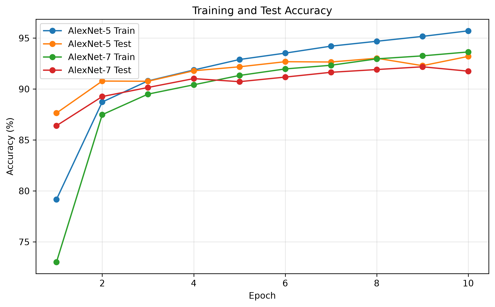
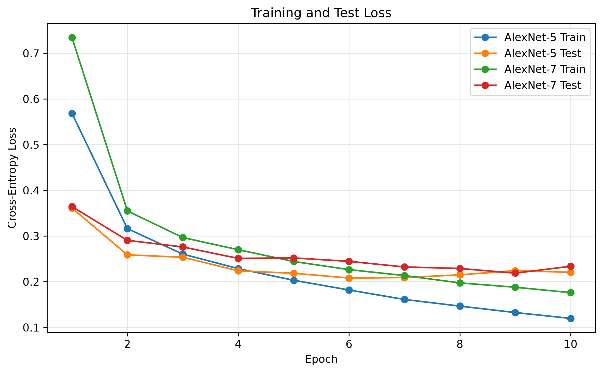

# AlexNet-Inspired CNN for FashionMNIST

An implementation of an **AlexNet-inspired convolutional neural network (CNN)** for image classification on the FashionMNIST dataset using PyTorch.

This project compares two architectures with different convolutional depths:

* **AlexNet-5** — 5 convolutional layers
* **AlexNet-7** — 7 convolutional layers

The experiment evaluates whether increasing the convolutional depth improves classification performance under the same training configuration.

> **Note:** The original AlexNet was designed for large RGB ImageNet images. This project adapts the architecture for FashionMNIST's 28×28 grayscale images, so the models are referred to as **AlexNet-inspired/adapted architectures**.

---

## Project Objectives

This experiment focuses on four tasks:

1. Load and preprocess the FashionMNIST dataset.
2. Implement AlexNet-inspired CNN architectures.
3. Compare models with 5 and 7 convolutional layers.
4. Visualize training and test performance using TensorBoard and Matplotlib.

---

## Dataset

The project uses **FashionMNIST**, a dataset of grayscale images representing 10 clothing categories.

| Property        |         Value |
| --------------- | ------------: |
| Training images |        60,000 |
| Test images     |        10,000 |
| Image size      |       28 × 28 |
| Channels        | 1 (grayscale) |
| Classes         |            10 |

The classes are:

```text
T-shirt/top
Trouser
Pullover
Dress
Coat
Sandal
Shirt
Sneaker
Bag
Ankle boot
```

### Preprocessing

Pixel values are normalized using:

```python
Normalize((0.5,), (0.5,))
```

This maps the original approximately `[0, 1]` pixel range to approximately `[-1, 1]`.

The training and test datasets are kept separate throughout the experiment.

---

## Model Architectures

Two CNN architectures were implemented from scratch using PyTorch.

### AlexNet-5

The model contains:

* 5 convolutional layers
* ReLU activations
* 2 max-pooling layers
* 3 fully connected layers
* Dropout in the fully connected layers
* 10 output classes

### AlexNet-7

The second model extends the convolutional feature extractor to:

* 7 convolutional layers
* ReLU activations
* 2 max-pooling layers
* 3 fully connected layers
* Dropout in the fully connected layers
* 10 output classes

Both models use the same classifier structure so that the main experimental difference is convolutional depth.

---

## Experimental Configuration

Both models were trained under the same configuration.

| Setting       | Value              |
| ------------- | ------------------ |
| Framework     | PyTorch            |
| Device        | Apple MPS          |
| Batch size    | 128                |
| Epochs        | 10                 |
| Optimizer     | Adam               |
| Learning rate | 0.001              |
| Loss function | Cross-Entropy Loss |
| Activation    | ReLU               |
| Dropout       | 0.5                |
| Random seed   | 42                 |

The same dataset preprocessing, optimizer, learning rate, batch size, and number of epochs were used for both architectures.

---

## Results

### Final Performance

| Model     | Conv. Layers | Parameters | Train Accuracy | Test Accuracy | Train Loss |  Test Loss |
| --------- | -----------: | ---------: | -------------: | ------------: | ---------: | ---------: |
| AlexNet-5 |            5 |  8,106,762 |         95.71% |    **93.20%** |     0.1198 | **0.2207** |
| AlexNet-7 |            7 |  9,286,922 |         93.64% |        91.75% |     0.1762 |     0.2338 |

AlexNet-5 achieved a test accuracy of **93.20%**, while AlexNet-7 achieved **91.75%**.

The difference in final test accuracy was:

```text
93.20% - 91.75% = 1.45 percentage points
```

### Training Curves

#### Accuracy



#### Loss



---

## Analysis

### 1. Increasing depth did not improve test performance

Under the experimental configuration used in this project, adding two additional convolutional layers did not lead to higher test accuracy.

AlexNet-5 achieved:

```text
Test Accuracy: 93.20%
```

while AlexNet-7 achieved:

```text
Test Accuracy: 91.75%
```

Therefore, for this particular FashionMNIST experiment, greater convolutional depth did not automatically result in better test performance.

### 2. AlexNet-5 fitted the training data more strongly

By the end of training, AlexNet-5 reached:

```text
Training Accuracy: 95.71%
Training Loss:     0.1198
```

compared with AlexNet-7:

```text
Training Accuracy: 93.64%
Training Loss:     0.1762
```

This indicates that AlexNet-5 achieved lower training error under the same 10-epoch training schedule.

### 3. Some overfitting is visible in AlexNet-5

During the later epochs, AlexNet-5's training loss continued to decrease while its test loss fluctuated.

The training accuracy also continued increasing while test accuracy showed smaller improvements.

This creates a larger train-test gap toward the end of training and suggests **some degree of overfitting**.

However, the test accuracy remained relatively stable, so the results do not indicate severe overfitting within this 10-epoch experiment.

### 4. A smaller train-test gap does not necessarily mean higher test performance

AlexNet-7 maintained a smaller gap between training and test performance than AlexNet-5.

However, its final test accuracy was also lower.

This illustrates an important point in model evaluation:

> A smaller train-test gap alone does not establish better generalization. Test-set performance must also be considered.

---

## TensorBoard Visualization

Training metrics were logged using TensorBoard.

The following metrics were recorded for both models:

* Training loss
* Test loss
* Training accuracy
* Test accuracy

Launch TensorBoard from the project directory with:

```bash
tensorboard --logdir=runs
```

Then open the local TensorBoard address shown in the terminal.

The TensorBoard logs are intentionally excluded from the Git repository because they are generated experiment files.

---

## Generating Result Figures

The `plot_results.py` script reads the TensorBoard event files and generates publication-style PNG figures for the README.

Run:

```bash
python plot_results.py
```

The figures are saved to:

```text
results/
├── accuracy_curves.png
└── loss_curves.png
```

---

## Project Structure

```text
CNN_AlexNet_FashionMINST/
│
├── data/
│   └── FashionMNIST/
│
├── results/
│   ├── accuracy_curves.png
│   └── loss_curves.png
│
├── models.py
├── train.py
├── test_data.py
├── test_models.py
├── plot_results.py
├── requirements.txt
├── .gitignore
└── README.md
```

The dataset and TensorBoard event files are generated locally and are not included in the repository.

---

## Installation

Create and activate a Python environment, then install the required packages:

```bash
pip install -r requirements.txt
```

The main dependencies are:

```text
PyTorch
Torchvision
TensorBoard
Matplotlib
```

---

## Running the Project

### 1. Test the data pipeline

```bash
python test_data.py
```

This verifies:

* FashionMNIST loading
* image and label dimensions
* normalization
* device selection

### 2. Test the model architectures

```bash
python test_models.py
```

This verifies that both models produce the expected output shape:

```text
[batch_size, 10]
```

### 3. Train both models

```bash
python train.py
```

The script trains AlexNet-5 and AlexNet-7 for 10 epochs and records the results to TensorBoard.

### 4. Generate figures

```bash
python plot_results.py
```

---

## Reproducibility

A fixed random seed is used:

```python
SEED = 42
```

The same seed and training configuration are applied to both model experiments to make the comparison more controlled.

Because training is performed on Apple MPS, exact numerical results may still vary slightly across hardware, PyTorch versions, or system environments.

---

## Technologies

* **Python**
* **PyTorch**
* **Torchvision**
* **TensorBoard**
* **Matplotlib**
* **FashionMNIST**
* **Apple Metal Performance Shaders (MPS)**

---

## Key Takeaway

This experiment demonstrates that increasing CNN depth does not necessarily improve classification performance.

Under the tested configuration, the 5-convolutional-layer architecture achieved higher test accuracy than the 7-convolutional-layer architecture. At the same time, the training curves showed a larger train-test gap for AlexNet-5 toward the end of training.

The comparison highlights the importance of evaluating **both training behavior and held-out test performance**, rather than assuming that a deeper network will automatically generalize better.
